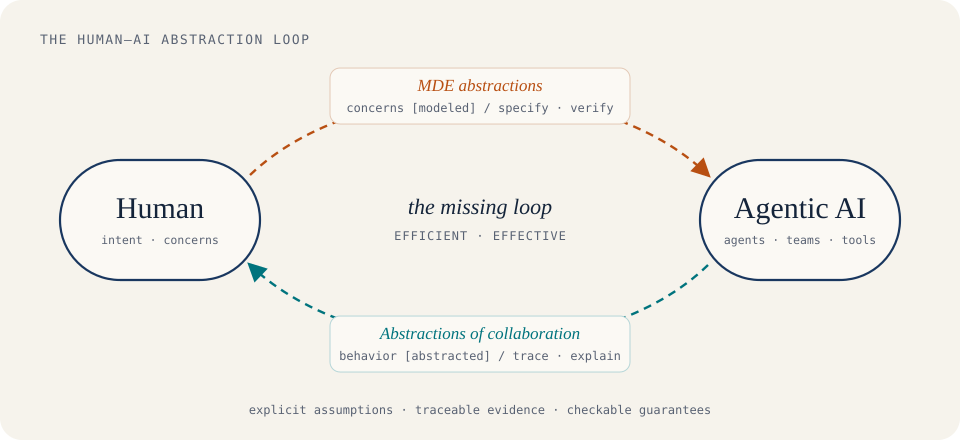

Agentic AI systems now plan, delegate, call tools, and collaborate with one another. Each new model makes the individual agents more capable. Yet when I look at how these systems are built and deployed, the hardest problems are not inside any single agent. They sit **between** people and agents.

I think about it as a very small state machine. It has two states, **Human** and **AI**, and two transitions between them. Each transition is triggered by a different kind of *abstraction*, seen from a different perspective.

## Transition 1: from human concerns to agents

People care about **higher-level concerns**: safety, correctness, intent, accountability, the constraints of an organization. Today most of those concerns reach an agent as informal prose in a prompt. The agent has no structured way to know which concerns apply, how they compose, or when they have been violated.

This is exactly the problem that **Model-Driven Engineering (MDE)** has worked on for decades. Models, contracts, and model transformations let us state concerns at the right level of abstraction and connect them, checkably, to what a system does. My group applies these techniques to agentic systems:

- **SkillSpec**, with Abbas Heydarnoori, accepted to the ICSE 2027 Research Track, is a formally verifiable specification format for composing agent skills.
- **Trust Is Not Transitive (TINT)**, submitted to *IEEE Transactions on Software Engineering*, specifies LLM guardrail hierarchies with contracts. It then verifies whether their composition still meets its safety requirements.
- **Safe Coordination of Untrusted AI Agents**, also submitted to *IEEE TSE*, places a deterministic controller between untrusted agent proposals and the shared state they change.
- **AutoM2M**, ongoing work, assembles agent teams through checked model transformations.

## Transition 2: from agent behavior to human understanding

The opposite direction matters just as much. When a team of agents succeeds or fails, a person needs to know **how** the agents collaborated and **why** the objective was or was not achieved. Raw transcripts, tool logs, and traces are abundant but nearly unreadable at scale. Humans need abstractions of agent behavior, not more data.

- **Agent Slicing**, submitted to *ACM TOSEM*, detects and localizes composition defects in multi-agent teams before execution. In our experiments, 36.1% of defect symptoms escaped individual-agent checks. Confirmed slicing detected 99.9% of those hidden symptoms without false findings, and pointed to the small group of components whose interaction explains each one.
- **AgentM2M**, submitted to the ICSE 2027 NIER track, represents hand-offs between agents as typed model-to-model transformations with persistent traces.
- **Heartness**, ongoing, takes a model-driven approach to *traceable* self-evolving agent harnesses.
- **TAAF**, published at ICSE 2026 with my former Brock M.Sc. students, combines knowledge graphs and LLMs so that developers can ask questions of large execution traces.

> One direction alone is not enough. Specifications without visibility cannot tell us whether they were honored. Visibility without specifications gives us nothing to check against.

## Why the loop is what is missing

Each transition exists in fragments today. What is missing is the **loop**: concerns flow down into agents as checkable models, and behavior flows back up to people as understandable abstractions. Each pass then informs the next.

For that loop to be useful in practice it has to be:

- **Effective.** Abstractions must sit at the level people reason about (goals, roles, guarantees) while staying precise enough for a machine to check.
- **Efficient.** Producing and checking them must be cheap enough to repeat every time a team, a prompt, or a model changes. This is why incremental rechecking, in Agent Slicing, and near-linear checking for fact-free guardrail hierarchies, in TINT, are design goals rather than afterthoughts.

## Where this comes from

This agenda grew out of earlier work. During my Ph.D., I used behavioral models to replay and regression-test distributed real-time systems (MReplayer, MRegTest, and a MODELS paper that received an ACM SIGSOFT Distinguished Paper Award). Later I learned how much structure can be recovered from what systems actually do: execution traces (TAAF), semantic change impact (SIKG), and technical-debt chains (RapidPay). Agentic AI brings both threads together. Explicit models make assumptions visible, and recovered evidence keeps those models honest.

Three principles guide the work: **explicit assumptions, traceable evidence, and checkable guarantees.**

## Join the effort

If you are a student or researcher interested in model-driven engineering, software testing, or trustworthy agentic systems, I would be glad to hear from you at [majid.babaei@ufv.ca](mailto:majid.babaei@ufv.ca). Code for most of these projects is open on [GitHub](https://github.com/ai4se4ai-lab), and the [AI4SE4AI Lab](https://ai4se4ai-lab.github.io/) site maps how they fit together.
