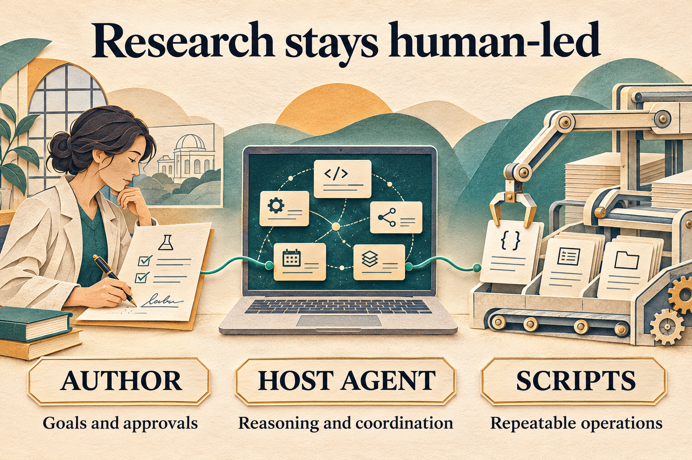
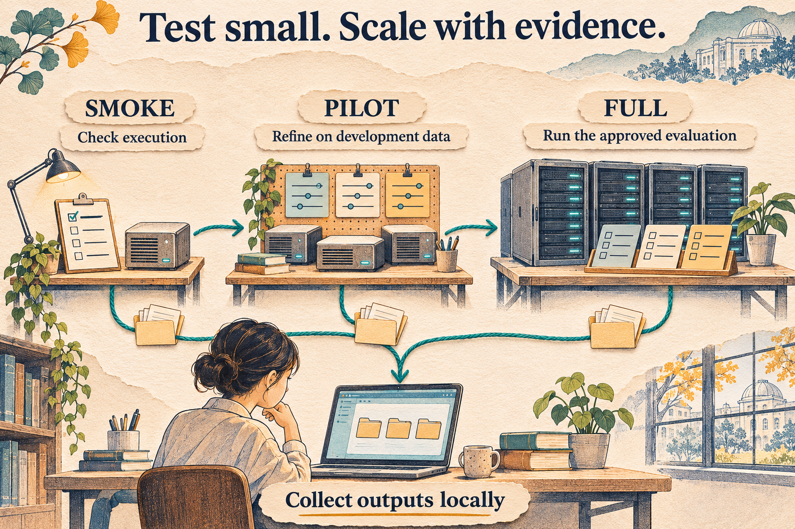

The most expensive mistake in a research project can happen before the first experiment runs: choosing an evaluation that cannot support the claim you want to make.

You discover a missing baseline while writing Related Work. A promising result came from a pilot run. A figure looks convincing, but its source data is unclear. A cluster job finished successfully, yet the outputs cannot reproduce the table in the manuscript.

Generating better prose does not resolve these problems. Connecting the research process does.

That is the motivation behind my development of **PaperOrchestra-HPC**: a workflow that connects a research codebase, literature review, experiment planning, HPC execution, evidence auditing, and manuscript development.

The question guiding this development is simple:

**Can we follow a claim backward from the paper to the evidence—and forward from the code to the paper?**

Explore the repository: [ai4se4ai-lab/paper-orchestra-hpc](https://github.com/ai4se4ai-lab/paper-orchestra-hpc).

## How the project evolved

The earlier PaperOrchestra application focused on producing a manuscript from supplied research materials. Specialized agents handled outlining, literature, figures, writing, and refinement through direct calls to model providers.

That is a useful starting point. But who establishes what the code actually implements? Who checks whether the evaluation includes the right comparisons? How do the experiment outputs become evidence that writers can use accurately?

This development extends the workflow upstream. It gives an AI coding agent procedures and tools for inspecting the project, reviewing literature, planning experiments, operating on shared HPC infrastructure, collecting outputs, and assessing readiness before writing.

The earlier application remains under `legacy/`. The new workflow uses the existing host agent for reasoning and writing, supported by small Python utilities and project-local files.

The research trail becomes:

**Code → literature and gaps → approved plan → experiments → audited evidence → manuscript.**

## Three participants, with different responsibilities

The architecture separates research judgment from repeatable operations.

**The host agent** reads code, interprets studies, proposes experiments, examines results, and coordinates specialized roles. Ten role definitions cover work including codebase analysis, literature screening, gap analysis, results auditing, writing, and review. Delegation depends on the capabilities of the host environment.

**The scripts** handle inspectable operations: initialization, phase state, review records, experiment construction, cluster transport, result collection, citation resolution, compilation, and manuscript checks. They produce ordinary JSON, CSV, Markdown, and shell files.

**The author** approves scientific claims, review protocols, method changes, experiment plans, compute budgets, and the transition to writing. Cluster authentication and MFA also stay with the user.

The new workflow makes no direct LLM API calls, so it requires no additional LLM API key for its scripts. The host agent still has its own access requirements and costs; cluster access and optional scholarly credentials are separate.

*Human decisions, agent reasoning, and repeatable tools contribute different things.*

## Literature review can change the experiments

Related Work is often written after the evaluation. By then, discovering an overlooked benchmark or a close predecessor can mean substantial rework.

Here, literature review comes before the main experiment campaign.

The workflow records review questions, search queries, eligibility criteria, screening decisions, and extracted evidence. Source adapters support OpenAlex, arXiv, and optional Scopus access. Deduplication, separate screener records, agreement statistics, conflict resolution, snowballing, and synthesis make the process inspectable.

The gap analysis connects included studies to candidate contributions, novelty risks, and recommended baselines, datasets, metrics, and ablations. Recommendations carry priorities and expected costs. The author decides which changes enter the plan.

An empty cell in a literature matrix is a reason to investigate. Establishing a worthwhile contribution still requires scientific judgment. Search limits and unavailable full texts must remain visible, too.

## Turn the claim into a test before spending the budget

Experiment planning follows a concrete chain:

**Claim → research question → hypothesis → measurement → decision rule.**

Suppose we want to claim that a method improves performance over a baseline. The plan should specify which baseline, which dataset version and split, which seeds, which metric implementation, and which uncertainty estimate—and what outcome would support the claim.

The workflow distinguishes three kinds of runs:

- **Smoke:** Does the execution path work on this cluster?
- **Pilot:** What needs debugging or tuning on development data?
- **Full:** Does the approved evaluation support the research claims?

That distinction matters. A successful smoke test establishes very little about scientific performance. Pilot results should not quietly become final evaluation results. Changes to the approved plan need dated explanations, including whether relevant results had already been observed.

## Give HPC experiments a durable record

Experiments are described in JSON specifications: commands, parameter matrices, resources, environment settings, and concurrency limits. The controller expands them into inspectable task scripts and Slurm arrays, which can be distributed across selected clusters.

For illustration, two methods × two datasets × three seeds creates 12 tasks. That is a matrix example, not a reported experiment result.

The user opens authenticated SSH sessions. Automated commands reuse those sessions in batch mode. The controller supports deployment, environment preparation, submission, monitoring, retries, fetching, collection, and allocation accounting.

Run manifests record rendered commands, task variables, Git information, and selected environment details. Task metadata captures execution information and return codes. Outputs are fetched into the research project for local analysis.

This gives researchers a concrete trail to inspect when a task fails—or when a result looks surprisingly good. Project-specific analysis scripts still have to define the actual metrics and regenerate the tables. Provenance also needs care around mutable environments and retries that may use newer code.

*Validate execution, refine on development data, then run the approved evaluation.*

## A finished job is the beginning of evidence checking

A process can exit successfully while producing an incomplete or misleading evaluation.

The results auditor checks planned coverage, exclusions, variability, statistical decision rules, and possible leakage or selective reporting. It re-derives headline values from raw outputs and compares them with the analysis tables.

The resulting readiness report maps claims to evidence and identifies blocking issues. The author reviews it before approving manuscript work. The state tool normally blocks paper-phase transitions until that approval is recorded; it remains a recorded gate with an override, rather than proof that the science is correct.

A missing baseline may require another experiment. An unsupported improvement may require a narrower claim. Both are useful outcomes of an audit.

## Write from the evidence—and preserve the route back

Writing begins from structured materials describing the implemented method, exact results, uncertainty, failure cases, and source files.

Bibliographic resolution matches references against scholarly indexes. LaTeX builds and static checks flag issues such as unresolved references, missing figures, placeholders, and numbers absent from supplied evidence. Data plots should be regenerated from actual outputs.

These checks complement human review. A matching citation record establishes that a publication exists; reading it establishes whether it supports the sentence. Finding the same number in an evidence file does not establish that it belongs to the right dataset or method.

A paper-to-code map connects manuscript sections, tables, figures, code, experiment specifications, runs, and result files. Review and refinement use versioned snapshots. Requests requiring new experiments are recorded for follow-up rather than answered with invented results.

*Every major claim should have a route back to the artifacts that support it.*

## What has been validated—and what comes next

The development report records **22 passing offline tests** at implementation commit `3699f6b`. They exercise local behaviors including matrix expansion, task splitting, smoke-history checks, collection, literature records, state gating, manuscript checks, and a minimal LaTeX build.

That validation does not establish a successful live HPC campaign or measured improvements in research quality, cost, or acceptance rates. Some safeguards are executable checks; others are procedures that the author and agent must follow. Stronger content-linked smoke validation, immutable retry provenance, and artifact transfer checks are useful next steps.

The foundation is now available for researchers to try on a bounded project and help improve.

Start by connecting the tool to your research repository, inspecting what already exists, and agreeing on the review and experiment plan. Adapt the example commands to your code. Inspect a small smoke run before scaling up, then follow one claim all the way from its raw outputs to its manuscript wording.

If you work on experimental AI, software engineering, or computational research, I invite you to explore the repository, try the workflow, and share concrete issues or contributions.

**Which part of your research process is hardest to trace today: the literature, the experiments, or the claims?**

[Explore PaperOrchestra-HPC on GitHub](https://github.com/ai4se4ai-lab/paper-orchestra-hpc)

*Development basis: the author-supplied report dated November 26, 2026, describing [implementation commit 3699f6b](https://github.com/ai4se4ai-lab/paper-orchestra-hpc/commit/3699f6bc5419b730fed2689278b87b3a59b7e0b6). Test results above are reported from that development, not a new test run. The four AI-generated editorial illustrations explain concepts; their chart-like marks do not represent measured results.*
